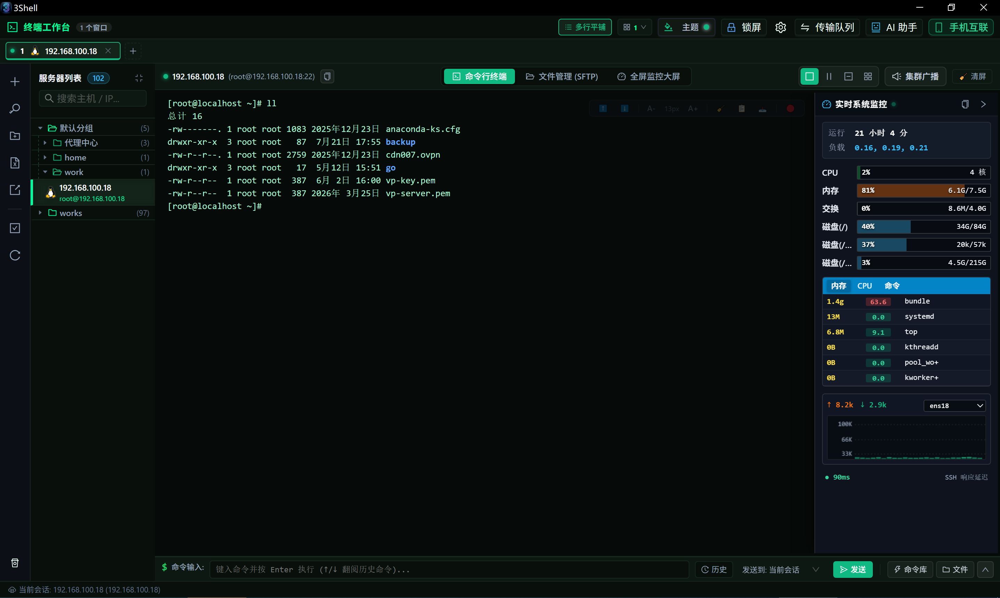
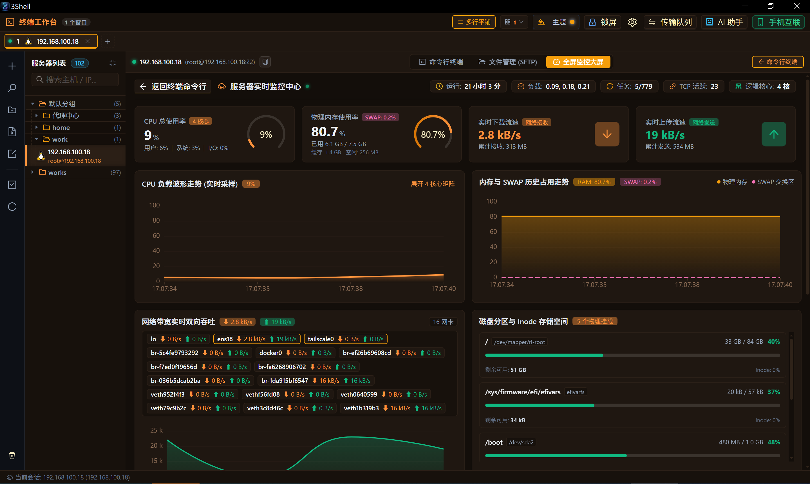
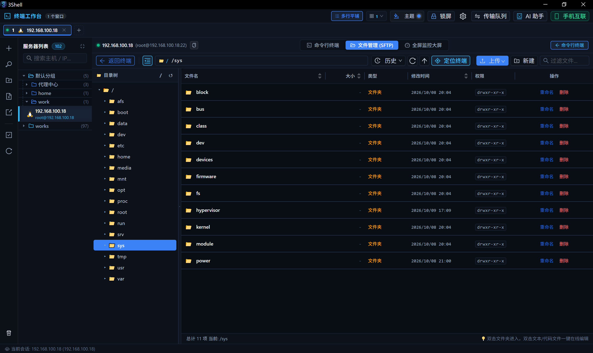
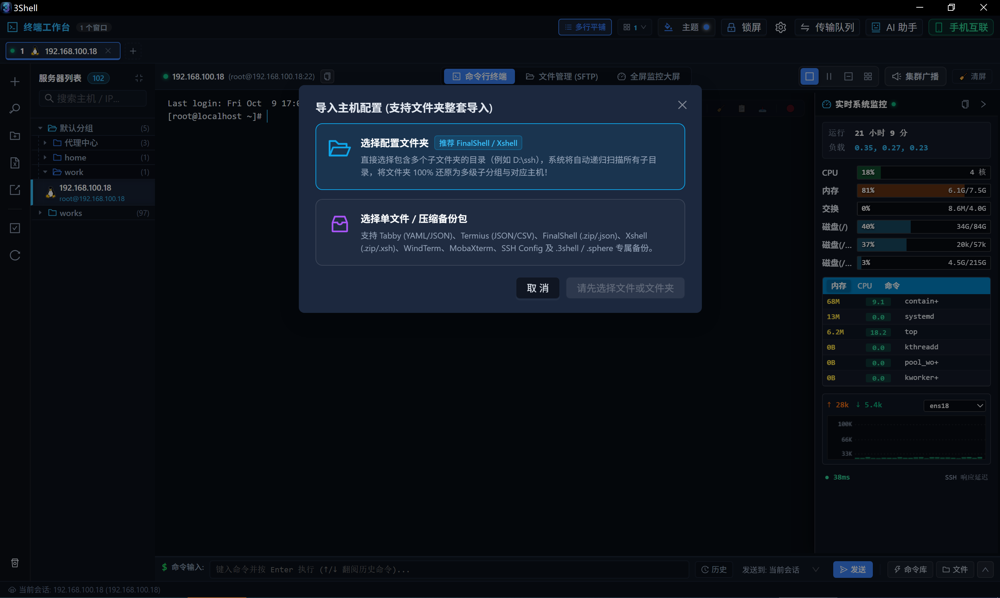

# 3Shell - 现代化极速跨平台桌面运维终端利器

  

  <strong>新一代现代化、轻量级、跨平台的服务器运维终端与综合管理工具</strong>

  <em>拒绝卡顿臃肿 · 纯本地硬件级安全防护 · 0 Agent免探针全景监控 · 深度集成 AI 运维助手</em>

  
  
  
  
  
  

---

## 🌟 为什么选择 3Shell？

在长期的运维与开发实践中，传统终端工具常伴随 **体积庞大臃肿（动辄上百兆）、冷启动缓慢、内存暴涨卡死、UI界面老旧、数据上云泄露风险** 等痛点。

**3Shell** 专为系统架构师、SRE 及后端开发者量身打造，采用现代轻量桌面引擎结合高性能底层调度。在体积控制上达到极致：**Windows 版安装包仅 11.1 MB，macOS 版仅 18.6 MB**（仅为同类工具的 1/10），真正实现秒级下载、毫秒级瞬时冷启动；同时日常空载仅占用约 **68MB** 内存，兼具高颜值界面与坚若磐石的稳定性。

> 🔒 **安全承诺与数据自主权**：所有主机凭据、密码与密钥数据**100% 留存在本地**，采用企业级高强度加密隔离存储，**绝不上云**，杜绝供应链风险与敏感资产泄露。

---

## 📸 核心界面与实测展示

### 1. 沉浸式终端工作台 & 实时系统悬浮监控
支持无限级主机分组树检索、多标签横滚/平铺、分屏矩阵及集群广播下发，右侧无缝挂载系统指标微型看板。

  

---

### 2. 全景系统性能大屏 · 零 Agent 侵入式直采
**无需在目标服务器部署任何 Agent 探针**！通过标准化安全通道流式采样，动态呈现多核 CPU 细粒度走势、物理内存划分、网络多网卡实时吞吐与磁盘 Inode 空间监控。

  

---

### 3. 可视化 SFTP 文件管理器 & 在线代码编辑
打破传统命令行与文件工具割裂的壁垒。内置远程树形文件浏览、权限属性管理与大文件双向分块断点续传保护；支持双击实时在线查看和编辑服务器脚本配置，并提供**一键精准同步定位至终端当前路径**。

  

---

### 4. 专业级服务器配置 & 一键测试连通性
支持 Linux (SSH) 与 Windows 远程桌面一键拉起。内置常用凭据资产库、代理穿透与端口转发隧道。保存前支持毫秒级预连通性握手诊断，排查网络与权限问题。

  

---

### 5. AI 智能运维副驾驶 · 集成 DeepSeek 与本地离线大模型
深度集成通用代码大模型（DeepSeek）与本地私有化离线模型（Ollama）。自动识别终端选中的报错上下文日志，支持**一键右键诊断根因**并给出修复建议，复杂 Shell 管道指令一键生成。

  

---

### 6. 0 成本无痛平替 · 支持多款主流工具整套导入
支持直接选择包含数百台主机的原配置目录，一键递归解析并 100% 还原层级分组树。全面兼容 FinalShell、Xshell、Termius、Tabby 等主流备份格式，无缝迁入，即刻接管。

  

---

## ⚡ 核心功能亮点一览

- 🚀 **极致轻量小巧**：安装包极度精简（**Windows 仅 11.1 MB / macOS 仅 18.6 MB**），体积仅同类工具的十分之一，告别动辄数百兆的臃肿安装包与卡顿；毫秒级冷启动，日常待机内存控制在约 68MB。
- 🖥️ **硬件加速终端**：自适应 4K 高分屏，极速渲染高吞吐日志输出，平滑滚屏不丢帧。
- 🔲 **多屏矩阵与广播**：支持 1x1、1x2、2x2 多窗口矩阵协同，底栏指令一键并发推送至全部或指定分屏。
- 📁 **SFTP 断点续传**：大文件多线程分块双向传输，遇意外断网自动保留断点，支持网络恢复后续传。
- 📊 **免探针实时监控**：无入侵式操作系统健康状态采集，无需额外开放端口或常驻守护进程。
- 🛡️ **本地密态存储**：所有配置和私钥严格基于硬件级认证算法在本地加密，坚决捍卫数据主权。
- 🌐 **全平台原生支持**：覆盖 Windows 10/11、macOS (Apple Silicon & Intel) 以及主流 Linux 发行版。

---

## 🔄 核心指标横向对比

| 评测维度 | 3Shell | 传统老牌客户端 (如 Xshell / SecureCRT) | 重型基于 Java / 厚重方案 (如 FinalShell) |
| :--- | :--- | :--- | :--- |
| **安装包体积** | **极度精简 (Win 11.1MB / Mac 18.6MB)** | 中等 (~40MB - 60MB) | 庞大 (100MB ~ 250MB+) |
| **待机内存占用** | **极低 (~68MB)** | 较低 (~100MB) | 极高 (300MB ~ 1.5GB+) |
| **冷启动速度** | **瞬时 (<0.3s)** | 快 (~1s) | 缓慢 (3s ~ 8s) |
| **服务器性能大屏** | **原生集成 (免 Agent)** | ❌ 无 (需借助第三方) | 内置 (但常随主机增加严重卡顿) |
| **SFTP 体验** | **内置可视化 + 断点续传** | 分离为独立 Xftp 窗口 | 内置树形 |
| **AI 运维赋能** | **DeepSeek + 本地离线模型** | ❌ 无 | ❌ 无 |
| **数据上云隐患** | **纯本地强加密存储** | 本地文件明文/轻混淆 | 需警惕账号云同步泄露 |
| **资产迁移成本** | **0成本（文件夹整套导入）** | 格式封闭 | 格式私有 |

---

## 📥 获取与体验

- **官方网站**：[https://3shell.com](https://3shell.com)
- **支持架构与安装包**：
  - **Windows**：Windows 10 / 11 / Windows Server (x64) · **仅 11.1 MB**
  - **macOS**：macOS 11.0+ (支持 Apple Silicon M系列与 Intel 双架构) · **仅 18.6 MB**
  - **Linux**：Ubuntu, Debian, CentOS, Fedora, Arch Linux 等主流发行版

欢迎前往官方网站免费下载体验！如果觉得好用，请向身边的运维与开发小伙伴推荐，期待你的反馈与建议。
